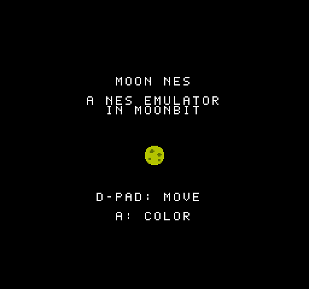

# moon_nes

**在线试玩：<https://sayoi7799.github.io/moon_nes/>**（打开就运行内置演示，可以切换到 Snake、Pong，或载入自己的 ROM；支持键盘和手柄）



用 MoonBit 编写的 NES（红白机）模拟器，有画面也有声音。核心与平台无关，可以编译到 js、wasm-gc、native 三个后端；附带一个浏览器前端和几个命令行工具。

## 定位

NES 的硬件行为有完整的公开文档（[NESdev Wiki](https://www.nesdev.org/wiki/)），社区也有公认的测试 ROM，模拟得对不对可以客观验证。MoonBit 生态里此前没有 NES 模拟器，也没有 6502 CPU 实现；最接近的是 [sacckey/lunaboy](https://github.com/sacckey/lunaboy)（Game Boy），CPU 和整机结构都不同。

本项目从零实现了 2A03 CPU（含 APU 的五个声道）、2C02 PPU 和五种常见卡带映射器（包括最常用的 MMC3），以周期为单位精确同步，并用 nestest 日志和 121 个测试 ROM 逐项验证。

## 支持范围

| 部分 | 内容 |
|---|---|
| 卡带 | iNES 解析、NES 2.0 头识别（12 位映射器号、子映射器、指数形式的 ROM 大小、RAM 大小字段）、trainer、兼容 "DiskDude!" 脏头；非法或截断的文件返回 `RomError`，不会崩溃 |
| CPU | 2A03（6502，无十进制模式）：151 条官方指令和常见非官方指令（LAX、SAX、DCP、ISB、SLO、RLA、SRE、RRA、ANC、ALR、ARR、AXS、LAS、SHA/SHX/SHY/TAS、各类 NOP、JAM）；每个周期一次总线访问，包括 dummy read/write；NMI 边沿检测、IRQ 电平触发、在倒数第二个周期采样中断、BRK/IRQ 被 NMI 劫持、同页跳转分支少采样一次 |
| PPU | 逐点推进（262 行 × 341 点）；背景取数流水线和 16 位移位寄存器；loopy v/t/x/w 滚动；精灵求值（含溢出标志的斜向扫描 bug 和置位时刻）；8 个精灵槽在第 257–320 点按实机时刻取图案，空槽读 tile $FF，预渲染行也取；精灵 0 碰撞、优先级、左 8 像素裁剪、8×16 精灵；VBlank/NMI 时序及 `$2002` 读取抑制；奇数帧跳点；`$2007` 读缓冲；调色板镜像；开路总线衰减 |
| 映射器 | 0 NROM、1 MMC1（SxROM/SNROM/SUROM，5 位串行移位寄存器，忽略相邻周期的连续写，MMC1B 的 PRG RAM 禁用）、2 UxROM、3 CNROM、4 MMC3（TxROM：8 KiB PRG 和 1/2 KiB CHR bank、A12 反转、H/V 镜像、四屏幕卡带、`$A001` 的 PRG RAM 开关和写保护；扫描线 IRQ 按 PPU A12 的上升沿计数，A12 需先保持低电平 9 个点；NES 2.0 子映射器 4 按 MMC3A 的 IRQ 规则） |
| APU | 帧计数器（4/5 步模式，1/4 帧和半帧时钟、帧 IRQ、`$4017` 写入的 3/4 周期延迟）；两个方波（包络、扫频、方波 1 反码/方波 2 补码取负、周期 < 8 或目标 > $7FF 静音）；三角波（线性计数器，停住时保持电平）；噪声（15 位 LFSR、长/短模式）；DMC（内存读取器、1 字节缓冲、IRQ、循环）；上电和复位时 `$4015`/`$4017` 的状态 |
| DMC DMA | 取样本字节时让 CPU 停 3–4 个周期（halt、dummy、可选的对齐、get），在 OAM DMA 中只多占 2 个周期；停顿期间重复 CPU 原本的读，因此 `$2007` 会被多读，而连续读 `$4016/$4017` 只移一位 |
| 声音输出 | 非线性混音（NESdev Wiki 的精确公式，预先算成表）；每个 CPU 周期的输出按区间平均降到输出采样率（默认 48 kHz），再经过 90 Hz 高通和 14 kHz 低通；只用加减乘除，三个后端的采样逐位一致 |
| 其他 | 标准手柄（`$4016/$4017`）、OAM DMA（513/514 周期） |
| API | `Nes::load_rom`、`run_frame`、`step`、`frame_buffer`（256×240）、`write_rgba`、`set_buttons`、`reset`、`frame_hash`、`screen_text`、`set_sample_rate`、`samples_available`、`take_samples`；CPU 包可以单独使用，通过 `CpuBus` trait 接任意总线 |
| 浏览器前端 | canvas 显示、键盘和手柄（Gamepad API）、Web Audio 播放（AudioWorklet + 动态速率控制）、打开即运行内置演示、内置 Snake 和 Pong、载入本地 ROM；在线版本由 GitHub Pages 自动发布 |
| 命令行工具 | `nestest`（与 nestest.log 逐行对照）、`testroms`（输出测试 ROM 结果表）、`bench`（测速）、`screen`（打印屏幕文字和帧哈希）、`snapshot`（把画面存成 PNG） |

不支持：其他映射器（包括 MMC6 的 PRG RAM 和 MMC3 的变体板子 TxSROM/TQROM）、存档和即时存档、32 KiB WRAM 分页的 SXROM/SOROM、PAL 机型、扩展音源。三角波周期小于 2 时会产生超声波，这里让它停住，和多数模拟器一样。

## 测试结果

`moon test` 在 js、wasm-gc、native 三个后端都通过（98 个测试）。下面的结果由 `moon run src/cmd/testroms` 生成，**121 个 ROM 中 113 个通过**，另外 nestest 的 8991 行全部一致：

| 部分 | 通过 / 总数 | 没通过的 |
|---|---|---|
| CPU | 28 / 28 | 无 |
| PPU | 32 / 33 | 2005 年的 `vbl_clear_time` |
| APU | 26 / 30 | 2005 年 APU 测试 09–11；`double_2007_read`（PPU 的连续读，与 DMC 无关） |
| 映射器 | 27 / 30 | 测 MMC3A、MMC6 这两种芯片版本的 3 个测试（改成 NES 2.0 子映射器 4 后通过） |

每个没通过的 ROM 的原因写在下面各节和 `src/nes/rom_suite_test.mbt` 的「已知未通过」清单里。

### CPU

| 测试 ROM | 测什么 | 结果 |
|---|---|---|
| nestest.nes + nestest.log | 全部官方指令和非官方指令的结果、标志位、周期数；与参考日志的 8991 行逐行对比，包括内存注释和 PPU 位置 | ✅ 8991/8991 行一致 |
| instr_test-v5 01–16 | 每条指令在各寻址模式下的结果（含非官方指令） | ✅ 16/16 |
| instr_timing 1-instr_timing、2-branch_timing | 每条指令的周期数、分支的周期数 | ✅ 2/2 |
| instr_misc 01–04 | abs,X 环绕、分支环绕、dummy read（含 APU 寄存器） | ✅ 4/4 |
| cpu_dummy_reads | LDA/STA 各寻址模式产生的 dummy read 对 PPU 寄存器的副作用 | ✅ |
| cpu_interrupts_v2 1–5 | CLI 延迟、NMI 与 BRK、NMI 与 IRQ、IRQ 与 DMA、分支延迟 IRQ | ✅ 5/5 |

### PPU

| 测试 ROM | 测什么 | 结果 |
|---|---|---|
| ppu_vbl_nmi 01–10 | VBL 置位/清除时刻、NMI 开关时序、`$2002` 抑制、奇偶帧跳点 | ✅ 10/10 |
| sprite_hit_tests_2005.10.05 01–11 | 精灵 0 碰撞：基础、对齐、角、翻转、左裁剪、右边缘、屏幕底部、8×16、时序 | ✅ 11/11 |
| sprite_overflow_tests 1–5 | 精灵溢出：基础、细节、时序、硬件 bug、模拟器常见错误 | ✅ 5/5 |
| blargg_ppu_tests_2005.09.15b palette_ram、power_up_palette、sprite_ram、vram_access | 调色板读写与镜像、上电调色板、OAM 读写、VRAM 读缓冲 | ✅ 4/4 |
| blargg_ppu_tests_2005.09.15b vbl_clear_time | VBL 在 NMI 之后约 2270 周期清除 | ❌ code 2（判定 VBL 清除得太早） |
| oam_read | `$2004` 读取 | ✅ |
| ppu_open_bus | PPU 开路总线及衰减 | ✅ |

`vbl_clear_time` 是 2005 年的旧测试，只给 NMI 延迟留了约 4 个周期的余量，对上电时 CPU 与 PPU 的相位很敏感。测同一件事的新版测试 `ppu_vbl_nmi/03-vbl_clear_time` 和 `05-nmi_timing` 都已通过。

### APU

| 测试 ROM | 测什么 | 判定方式 | 结果 |
|---|---|---|---|
| apu_test 1–6 | 长度计数器、长度表、帧 IRQ 标志、时钟抖动、长度时钟时刻、IRQ 标志时刻 | $6000 | ✅ 6/6 |
| apu_test 7-dmc_basics、8-dmc_rates | DMC 的启动、停止、IRQ、循环、1 字节缓冲；16 种速率 | $6000 | ✅ 2/2 |
| apu_reset 6 个 | 上电和复位时 `$4015`、`$4017`、IRQ 标志、长度计数器的状态，`$4017` 的 9–12 周期延迟 | $6000，测试中途要求按复位键 | ✅ 6/6 |
| blargg_apu_2005.07.30 01–08 | 帧计数器和长度计数器的旧版时序测试 | 屏幕上的 `$XX` 结果码，`$01` 为通过 | ✅ 8/8 |
| blargg_apu_2005.07.30 09–11 | 复位后第四步的时刻；在长度时钟的同一周期改 halt 或重新装载 | 同上 | ❌ code 4、3、4 |
| dmc_dma_during_read4 dma_2007_write、dma_4016_read、read_write_2007 | DMC DMA 落在 `$2007` 写、`$4016` 读、读写交替时的副作用 | 屏幕 Passed | ✅ 3/3 |
| dmc_dma_during_read4 dma_2007_read | DMC DMA 落在 `$2007` 读上，多读 2–3 次 | 屏幕 CRC 属于源码列出的实机结果 | ✅ |
| dmc_dma_during_read4 double_2007_read | 连续两个周期读 `$2007` | 同上 | ❌ CRC 不在列表中 |

未通过的原因：
- 2005 年测试的 09–11 认为长度时钟比现在早 1 个周期。测同样内容的新版测试（`apu_test` 5、6 和 `apu_reset/4017_timing`）全部通过，把时钟提前 1 个周期反而会让它们失败，所以保持现状。
- `double_2007_read` 与 DMC 无关：实机上连续两个周期读 `$2007` 时，第二次读有时会被忽略，这里两次都让 VRAM 地址前进了。

没有加入套件的 APU 相关测试：
- `dmc_tests` 的 4 个 ROM 和 `sprdma_and_dmc_dma`：没有说明文档，也不输出通过或失败（`sprdma_and_dmc_dma` 只显示数值表），无法自动判定。
- `apu_mixer` 的 4 个 ROM：要靠耳朵判断两次哔声之间是否接近无声。用本模拟器的采样输出测量：三角波的残余不到哔声音量的 2%，噪声按设计渐强渐弱；方波和 DMC 两项的残余明显，说明方波与 DMC 的相对时序或音量还有偏差。
- PAL 版的 APU 测试：不支持 PAL。

### 映射器

使用 [Holy Mapperel](https://github.com/pinobatch/holy-mapperel) v0.02（zlib 许可，ROM 随仓库提交）。它会自动识别映射器，检查每个 PRG/CHR bank、镜像方式和 PRG RAM，最后打印 4 位详细码，`0000` 表示全部正确。测试从名称表里读出映射器号和详细码来判定。

| ROM | 板子 | 结果 |
|---|---|---|
| M0_P32K_C8K_V | NROM，CHR ROM | ✅ 0000 |
| M0_P32K_CR8K_V | NROM，CHR RAM | ✅ 0000 |
| M1_P128K_C32K | MMC1，CHR ROM | ✅ 0000 |
| M1_P128K_CR8K | MMC1 SNROM，CHR RAM | ✅ 0000 |
| M1_P512K_CR8K_S8K | MMC1 SUROM，512 KiB PRG | ✅ 0000 |
| M2_P128K_V、M2_P128K_CR8K_V | UxROM | ✅ 0000 ×2 |
| M3_P32K_C32K_H | CNROM | ✅ 0000 |
| M4_P128K、M4_P128K_CR8K | MMC3，8 KiB CHR RAM | ✅ 0000 ×2 |
| M4_P128K_CR32K | MMC3，32 KiB CHR RAM | ✅ 0000 |
| M4_P256K_C256K | MMC3，256 KiB PRG 和 CHR ROM | ✅ 0000 |

MMC3 的 4 个 ROM 还检查 `$A001` 的 PRG RAM 写保护，没实现时详细码会是 `2xxx`。

MMC3 的扫描线计数器用 blargg 的三组测试验证。它们大多靠写 `$2006` 手动拨动 A12 来测计数器，`4-scanline_timing` 则测 IRQ 落在扫描线的哪一点：

| 测试 ROM | 测什么 | 结果 |
|---|---|---|
| mmc3_test_2 1-clocking | A12 上升沿让计数器减 1 或重装 | ✅ |
| mmc3_test_2 2-details | `$C000`/`$C001`/`$E000`/`$E001` 的细节：重装时机、写 `$C001` 不置 IRQ、关 IRQ 后计数器照常运行 | ✅ |
| mmc3_test_2 3-A12_clocking | 只有经过滤波的 A12 上升沿才计数 | ✅ |
| mmc3_test_2 4-scanline_timing | IRQ 在扫描线上的精确时刻（依赖精灵取数时刻） | ✅ |
| mmc3_test_2 5-MMC3 | MMC3B/C：latch 为 0 时每次计数都触发 IRQ | ✅ |
| mmc3_test_2 6-MMC3_alt | MMC3A：只在计数器变成 0 时触发 | ❌ code 2 |
| mmc3_test 1–5 | 旧版的同一组测试 | ✅ 5/5 |
| mmc3_test 6-MMC6 | MMC6 的 IRQ 行为（与 MMC3A 相同） | ❌ code 3 |
| mmc3_irq_tests 1–4、6.MMC3_rev_B | 2005 年版：计数、细节、A12、时序、MMC3B | ✅ 5/5 |
| mmc3_irq_tests 5.MMC3_rev_A | 2005 年版：MMC3A | ❌ |

三个 ❌ 测的都是另一种芯片版本。iNES 头没法说明卡带用的是哪种芯片，这里按最常见的 MMC3B/C 处理；NES 2.0 头标明子映射器 4 时才用 MMC3A 的规则。`src/nes/rom_suite_test.mbt` 里有一个测试把这三个 ROM 的头改成子映射器 4 再运行，三个都通过。

此外还有一个自制演示 ROM（见下文），在测试里模拟手柄输入，检查精灵坐标、画面和声音。

### 其他测试

- **画面回归**：9 个 ROM（5 个 Holy Mapperel，含 MMC3；sprite hit、instr_test；网页内置的 Snake 和 Pong，过了标题画面再玩两秒）运行固定帧数后，帧缓冲的 FNV-1a 哈希写在快照里；三个后端算出的哈希完全一致（`src/nes/frame_hash_test.mbt`、`src/demo/demo_test.mbt`）。
- **声音回归**：演示 ROM 按住 A 运行 300 帧，把全部采样量化成 16 位后做 FNV-1a 哈希，写在快照里；三个后端完全一致（`src/demo/demo_test.mbt`）。另有测试检查演示确实有声音、A 键会启动 DMC。
- **边界情况**：空文件、不足 16 字节、签名错误、PRG/CHR/trainer 截断、PRG 大小为 0、不支持的映射器（含 NES 2.0 的 256 号以上）都返回带说明的 `RomError`（`src/cartridge/cartridge_test.mbt`、`src/nes/nes_test.mbt`）。
- **单元测试**：CPU 中断与 DMA 周期、映射器 bank 切换、MMC1 串行写、MMC3 的 PRG/CHR bank、镜像、PRG RAM 保护、IRQ 计数器（重装、A12 滤波、新旧两种芯片在 latch 为 0 时的差别）、APU 帧 IRQ 与长度计数器、包络、扫频（两个方波的取负差异和静音条件）、占空比、三角波序列、噪声 LFSR 周期（32767 和 93）、DMC 装载延迟和 IRQ、降采样和滤波、总线镜像、手柄移位顺序等。

测试 ROM 结果会和 `src/nes/rom_suite_test.mbt` 里的「已知未通过」清单对比：清单外的 ROM 没过算回归；清单内的 ROM 变成通过也会报错，提醒更新清单和这张表。

## 安装与使用

在自己的 MoonBit 项目里添加依赖：

```bash
moon add sayoi7799/moon_nes
```

在要用模拟器的包的 `moon.pkg` 里导入整机包；示例用了内置的演示 ROM，所以也导入 `demo`：

```
import {
  "sayoi7799/moon_nes/nes",
  "sayoi7799/moon_nes/demo",
}
```

最小示例：加载 ROM、按住 Start 跑一帧、读取帧缓冲。

```moonbit
///|
fn main {
  // Any iNES file works here, for example bytes read from disk with
  // moonbitlang/x/fs. The demo ROM is built into the library.
  let rom = @demo.demo_rom()
  let nes = @nes.Nes::load_rom(rom) catch {
    err => {
      println("cannot load ROM: \{err.message()}")
      return
    }
  }
  // Player 1 holds Start during the next frame.
  nes.set_buttons(0, @nes.BUTTON_START)
  nes.run_frame()
  // 256x240 pixels, each an NES color index; pixel_rgb turns it into 0xRRGGBB.
  let frame = nes.frame_buffer()
  let rgb = @nes.pixel_rgb(frame[0])
  println("\{frame.length()} pixels, first pixel RGB \{rgb}")
}
```

这段代码就是仓库里的 [`src/examples/basic/main.mbt`](src/examples/basic/main.mbt)，有测试保证两者逐字一致。在本仓库里运行：

```bash
moon run src/examples/basic
```

加载自己的 ROM 文件时，把 `@demo.demo_rom()` 换成文件内容，例如用 `moonbitlang/x/fs` 的 `@fs.read_file_to_bytes(path)`。要显示画面，可以用 `write_rgba` 直接写出 256×240×4 的 RGBA 字节，`src/web` 就是这样把帧画到 canvas 上的。

声音：`set_sample_rate(rate)` 设置输出采样率（默认 48000；设为 0 关掉声音，可省下约 15% 的时间），每帧之后用 `take_samples(buf)` 取走这一帧的单声道采样（约 800 个，范围大致在 -1.0 到 1.0）。核心只生成采样，播放交给调用方。

## 如何运行

需要 MoonBit 工具链（开发时使用 moon 0.1.20261117 / moonc v0.10.21，CI 固定为同一版本）。

```bash
# 下载社区测试 ROM（不随仓库分发）
sh scripts/fetch-test-roms.sh

# 三个后端的测试
moon test --target js
moon test --target wasm-gc
moon test --target native

# 命令行示例：运行 nestest，与 nestest.log 逐行对照（加 -- --all 输出每一行）
moon run src/cmd/nestest

# 运行全部测试 ROM，输出 Markdown 结果表；可以加一个路径过滤词
moon run src/cmd/testroms --target native --release
moon run src/cmd/testroms --target native -- ppu_vbl

# 性能测试：无界面运行 600 帧
moon run src/cmd/bench --release --target js -- test-roms/holy-mapperel/M1_P128K_C32K.nes

# 打印某个 ROM 运行若干帧后的屏幕文字和帧哈希
moon run src/cmd/screen -- test-roms/holy-mapperel/M2_P128K_V.nes 600
```

### 浏览器

在线版本由 `.github/workflows/pages.yml` 在每次推送到 `main` 时构建 `web/` 并发布到 GitHub Pages（仓库的 Pages 来源需设为 GitHub Actions）。本地运行：

```bash
sh scripts/build-web.sh
python -m http.server -d web 8000
```

然后打开 <http://localhost:8000>。页面打开就运行内置演示；用选择框可以切换到内置的 Snake 和 Pong，也可以点 **Open ROM…** 或把 `.nes` 文件拖进画面。ROM 文件只在浏览器本地读取，不会上传。

键盘：方向键 = 十字键，`X`/`K` = A，`Z`/`J` = B，`Enter` = Start，`Shift` = Select。

手柄：页面每帧读取 Gamepad API，按浏览器的标准布局对应：十字键或左摇杆 = 十字键，右边的面键 = A，下边的面键 = B（和 NES 手柄上 A 在右、B 在左一致），Back = Select，Start = Start。键盘和手柄的按键分开记录、合在一起送给模拟器，可以同时使用。

声音用 Web Audio 播放。浏览器要求先有用户操作才能出声，所以画面上会提示，在页面任意位置第一次点击或按键时启动；**Mute** 静音，暂停时声音也一起暂停。页面每帧把采样发给 AudioWorklet（`web/audio-worklet.js`）里的环形缓冲。为了音画同步又不丢帧，页面把缓冲保持在约 50 ms：缓冲偏少时让核心多产生最多 0.5% 的采样，偏多时少产生。画面始终是 60 fps，0.5% 的音高变化听不出来。缓冲真的空了（例如标签页切到后台）时输出保持最后一个电平，避免爆音。

性能（600 帧，Holy Mapperel MMC1 ROM，release 构建，开着声音）：native 约 740–770 fps，wasm-gc 约 500 fps，js 约 280 fps，都远超 NES 的 60 fps。

## 结构

```
src/cartridge  iNES / NES 2.0 解析 → Cartridge
src/mapper     Mapper trait + NROM / MMC1 / UxROM / CNROM / MMC3
src/cpu        CpuBus trait + 2A03 核心 + 反汇编和 nestest 格式跟踪
src/ppu        逐点 PPU
src/apu        APU：帧计数器、五个声道、混音、降采样和滤波
src/bus        CPU 地址空间：RAM、PPU/APU 寄存器、手柄、DMA，实现 CpuBus
src/nes        整机和对外 API、调色板、测试 ROM 判定
src/demo       迷你 6502 汇编器 + 自制演示 ROM
src/examples/basic  README 里的最小使用示例
src/web        浏览器前端（只编译到 js）
src/png        最小的 PNG 编码器（截图用）
src/cmd/*      nestest、testroms、bench、screen、snapshot 命令行工具
web/           页面；web/roms/ 是内置的自制游戏
```

依赖方向是 cartridge ← mapper ← ppu ← bus ← nes ← web/cmd。cpu 不依赖任何包，只声明 `CpuBus` trait，因此可以单独接一块平坦 RAM 跑 nestest。

**CPU 与 PPU 的同步**：CPU 的每次读写正好是一个周期。总线在访问前让 PPU 走 2 个点、APU 走一步，访问后再走 1 个点，所以每个 CPU 周期是 3 个 PPU 点。CPU 在每个周期结束时采样中断线。把访问放在第 2 和第 3 个点之间，是 `ppu_vbl_nmi` 各项时序测试共同要求的位置。

**DMC DMA**：DMC 要取样本字节时，CPU 在下一个读周期前停下。停顿由 CPU 自己执行（`CpuBus` 的 `dmc_dma_pending` 和 `dmc_dma_cycle`，带默认实现），所以停顿周期也计入 CPU 周期数并照常看中断线，nestest 的周期列和中断时序都不受影响。DMC 没开时不会触发，现有的 CPU 和 PPU 时序测试结果不变。

**MMC3 与 PPU 的配合**：MMC3 的计数器看的是 PPU 地址线 A12，所以 PPU 必须在真实的时刻、用真实的地址取数。逐点 PPU 在第 1–256 点和第 321–336 点取背景，在第 257–320 点给 8 个精灵槽取图案（每槽 8 点，图案字节在第 4、6 点；空槽读 tile $FF；预渲染行也取）。每次读图案表（`$0000-$1FFF`），PPU 都调用 `Mapper::ppu_bus(地址, 点数)`；不渲染时写 `$2006`、读写 `$2007` 改变了 v，也会调用，因为这时地址总线上就是 v。名称表和属性的读取 A12 一定是低电平，所以不必通知。MMC3 记录 A12 什么时候变低，变高时如果已经低了至少 9 个点（约 3 个 CPU 周期，相当于 MMC3 等 M2 的 3 个下降沿），就让计数器走一步。常见设置（背景用 `$0000`、精灵用 `$1000`）下，每行在第 260 点左右走一步；同一行精灵槽之间的短暂低电平只有 4 点，被滤掉。

## 演示 ROM

`src/demo` 里有一个很小的 6502 汇编器（标签、分支偏移和地址回填），演示 ROM 在运行时由 MoonBit 代码汇编生成：屏幕上显示文字，十字键移动一个 16×16 的月亮精灵，按住 A 切换调色板并播放一段 DMC 采样。背景音乐是民歌《Mary Had a Little Lamb》（公有领域）的四声道编曲：方波 1 旋律、方波 2 和声、三角波低音、噪声鼓点。它完全由本仓库的代码生成，按本仓库的许可证分发，所以网页可以直接内置，不需要任何第三方 ROM。

## 参考范围

- 主要依据：NESdev Wiki 的硬件文档，包括 CPU、CPU interrupts、PPU rendering、PPU scrolling、PPU sprite evaluation、PPU registers、APU Frame Counter、APU Length Counter、APU Envelope、APU Pulse（含 Sweep）、APU Triangle、APU Noise、APU DMC、APU Mixer、DMA、iNES、NES 2.0、NROM、MMC1、UxROM、CNROM、NTSC video 等页面。
- 测试 ROM 的 readme 和源码注释：只用来了解每个测试的判定方式和期望输出。
- 没有参考任何其他模拟器的源代码，GPL 项目的代码一律没有看。调色板由 NESdev Wiki 记载的 NTSC 信号电平自行计算生成。

## 版权说明

- 本仓库**不包含、也不提供**任何商业游戏 ROM。浏览器前端只在本地读取用户自己提供的文件。
- 社区测试 ROM（blargg 的系列测试、kevtris 的 nestest 等）没有明确的再分发许可，所以不提交进仓库，由 `scripts/fetch-test-roms.sh` 从固定 commit 的 [christopherpow/nes-test-roms](https://github.com/christopherpow/nes-test-roms) 下载（CI 中同样如此）。
- `test-roms/holy-mapperel/` 中的 ROM 来自 Holy Mapperel v0.02，作者 Damian Yerrick，zlib 许可（允许再分发），原样提交并附带其 `LICENSE`。
- 演示 ROM 由本仓库代码生成。
- 网页内置的两个自制游戏是 Sebastian Dine 的 [openNES-Snake](https://github.com/sebastiandine/openNES-Snake) 1.0.9 和 [openNES-Pong](https://github.com/sebastiandine/openNES-Pong) 1.0.1，zlib 许可。`web/roms/` 里是作者发布的原版 ROM，未作修改，旁边附有许可证原文和来源说明。这两个仓库的 LICENSE 覆盖整个仓库，美术和音效没有另外标注许可。`web/` 不进入 mooncakes.io 的发布包。
- `docs/screenshot.png` 由 `moon run src/cmd/snapshot -- demo 120 docs/screenshot.png 2` 生成，画面来自本仓库的演示 ROM。

## 许可证

Apache-2.0，见 [LICENSE](LICENSE)。
